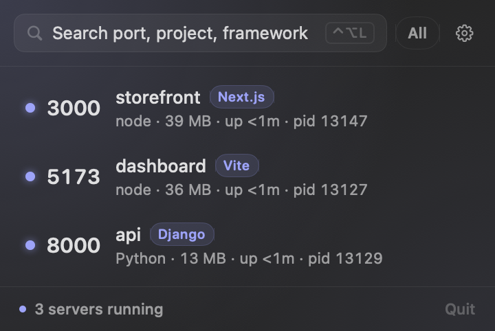
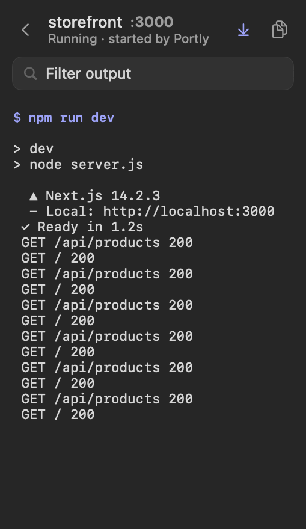
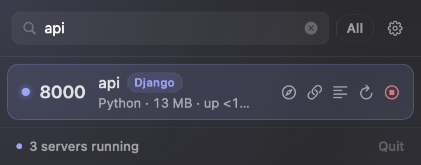

<h1 align="center">Portly</h1>

<p align="center">
  <b>Every dev server on your Mac, one keystroke away.</b><br>
  A tiny menu bar app that finds your running dev servers and lets you open, stop, restart and tail them.
</p>

<p align="center">
  
</p>

---

You start `npm run dev` in one terminal, a Django API in another, a Vite app somewhere else. An hour later: *what's on port 3000? Which terminal was that? Why is 5173 already in use?*

Portly sits in your menu bar and answers that. It shows every server you have running, with its project and framework, and gives you one-click actions for each.

## Features

- **Finds everything that's listening.** Port, project folder, framework, memory, uptime and pid for each server.
- **Knows your stack.** Next.js, Vite, Nuxt, Remix, Astro, SvelteKit, Angular, Express, NestJS, Django, FastAPI, Flask, Rails, Laravel, Phoenix and more, detected from the command line or the project's dependencies.
- **Ignores the noise.** Only dev servers by default. System and app listeners are one click away under **All**.
- **One-click actions.** Open in browser, copy URL, stop (a graceful SIGTERM first, then SIGKILL after 3 s if it hangs) and restart.
- **Smart restarts.** Relaunches the same command in the same folder through your login shell, so nvm, asdf, pyenv and friends just work. It restarts `npm run dev`, not the node process it happened to spawn.
- **Live logs.** Servers that Portly starts or restarts have their output captured: the last 5,000 lines, with follow, filter and copy.
- **Keyboard first.** <kbd>⌃</kbd><kbd>⌥</kbd><kbd>L</kbd> opens Portly from anywhere with search focused. Type a port, project or framework, then press <kbd>↩</kbd> to open it in your browser. You can change the shortcut.
- **Feels at home.** Designed for dark mode first, works in light mode, respects Reduce Motion, and has full VoiceOver labels.
- **Private.** No network access, no analytics, no accounts. Everything stays on your Mac.

<p align="center">
  
  &nbsp;&nbsp;
  
</p>

## Install

Requires **macOS 14 Sonoma or later**.

Signed and notarized downloads will be on the [Releases](../../releases) page soon. Until then, build it yourself:

```sh
git clone https://github.com/<you>/Portly.git
cd Portly
./build.sh Release
open build/DerivedData/Build/Products/Release/Portly.app
```

Or open `Portly.xcodeproj` in Xcode 16+ and press Run. There are no dependencies to install: Portly uses Apple frameworks only.

## Using Portly

| | |
|---|---|
| <kbd>⌃</kbd><kbd>⌥</kbd><kbd>L</kbd> | Open Portly from anywhere (configurable in Settings) |
| Type | Filter by port, project, framework or process name |
| <kbd>↑</kbd> <kbd>↓</kbd> | Move through the list |
| <kbd>↩</kbd> | Open the selected server in your browser |
| <kbd>esc</kbd> | Close (or go back from the log view) |
| Double-click a row | Open in browser |
| Right-click a row | All actions |

**About logs.** macOS doesn't let one app read another app's terminal output. So Portly can only show logs for servers it started. For a server you started in a terminal, the log view offers **Restart in Portly to capture logs**.

**About restarts.** Portly reruns the original command in the original folder through your login shell, so anything in your shell profile is restored. Environment variables you typed by hand into that one terminal session (`export API_KEY=…`) can't be recovered. Portly tells you this before restarting.

## How it works

Portly polls `lsof` for TCP listeners every 2 seconds while its menu is open, and every 10 seconds otherwise so the menu bar count stays right. For each process it reads the working directory, arguments, memory and start time straight from the kernel (libproc / sysctl). It then walks up to the nearest `package.json`, `.git`, `pyproject.toml`, `Gemfile`, `Cargo.toml` or `go.mod` to find the project.

A dev server is often a small family of processes, e.g. `npm run dev` → `node`, where only the last one holds the port. Stop and restart act on the whole family (up to, but not including, your shell), so nothing is left behind. Restarted servers write their output to a file that Portly tails, which means they keep running normally if you quit Portly.

```
Portly/
  App/       app entry, menu bar wiring, global-hotkey bridge
  Shell/     a small, testable wrapper around Process
  Data/      lsof parsing, process inspection, project + framework detection, the polling actor
  Control/   stopping, relaunching through the login shell, log capture
  State/     observable app state and settings
  Hotkey/    Carbon RegisterEventHotKey (no Accessibility permission needed)
  UI/        SwiftUI views, plus an NSTextView-backed log view
```

Built with SwiftUI (AppKit only where SwiftUI can't do the job), Swift 6 strict concurrency, and zero third-party packages.

## Development

```sh
./build.sh          # Debug build
./build.sh Release  # Release build
./build.sh test     # unit + integration tests
```

The tests start real processes: a Python HTTP server, an `npm run dev` launched the way Restart does it, a process that ignores SIGTERM, and a command that crashes on launch. They check detection, the npm→node job handling, log capture, the SIGKILL escalation and exit-code reporting.

> **Intel Macs with Xcode 26.5:** the new Swift driver can crash (`SIGILL`), and Xcode then reports *"Unable to discover swiftc command line tool info"*. `build.sh` handles this automatically. For the Xcode app, run `launchctl setenv SWIFT_USE_OLD_DRIVER 1` and restart Xcode.

Debug builds accept a few launch arguments for design work: `-PortlyOpenPopover`, `-PortlyAppearance dark|light` and `-PortlyGallery <dir>`, which renders the main screens to PNGs. They're documented in `Portly/App/DebugSupport.swift` and compiled out of Release builds.

Shipping a signed, notarized build: see [docs/RELEASING.md](docs/RELEASING.md).

## Contributing

Issues and pull requests are welcome, especially framework detection for stacks Portly doesn't recognise yet. That lives in `Portly/Data/ProjectDetector.swift` and comes with tests in `PortlyTests/ParsingTests.swift`. Please keep it dependency-free.

## License

[MIT](LICENSE) © 2026 Kilian Balaguer
