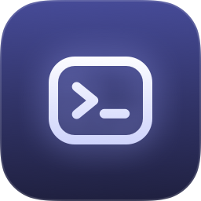
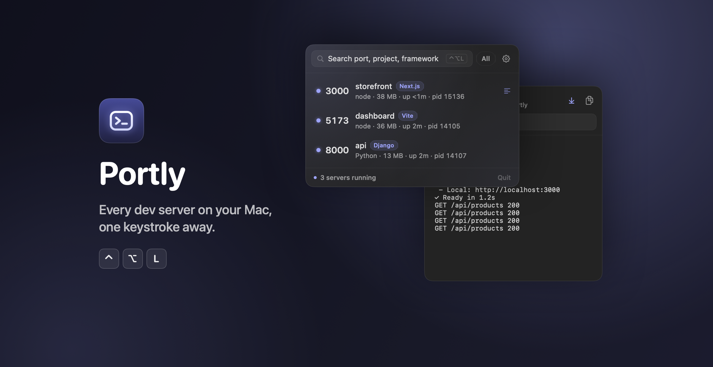
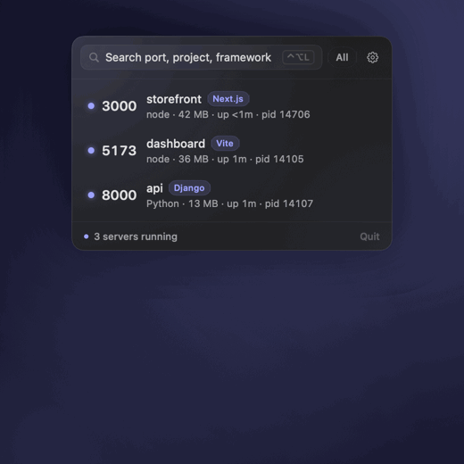

<div align="center">



# Portly

**Every dev server on your Mac, one keystroke away.**

A tiny, native menu bar app that finds the dev servers running on your Mac<br>
and lets you open, stop, restart and tail them, without hunting through terminals.

[](#install)
[](#how-it-works)
[](#how-it-works)
[](LICENSE)

[Install](#install) · [Features](#features) · [Keyboard](#keyboard) · [FAQ](#faq) · [How it works](#how-it-works)

<br>



</div>

<br>

## Why

You start `npm run dev` in one tab, a Django API in another, a Vite app somewhere else. An hour later:

> *What's on port 3000? Which terminal was that? Why is 5173 already in use?*

Portly lives in your menu bar and answers that at a glance. Press <kbd>⌃</kbd><kbd>⌥</kbd><kbd>L</kbd>, type a few letters, hit <kbd>↩</kbd>, and your app is open in the browser.

<div align="center">
  
  <br>
  <sub>Search, restart, and live logs: rendered from the real app.</sub>
</div>

## Features

<table>
<tr>
<td width="50%" valign="top">

### 🔎 Sees everything
Every listening server with its **port, project, framework, memory, uptime and pid**. System noise is hidden. Flip **All** to see every listener.

</td>
<td width="50%" valign="top">

### 🧠 Knows your stack
Detects **Next.js, Vite, Nuxt, Remix, Astro, SvelteKit, Angular, Express, NestJS, Django, FastAPI, Flask, Rails, Laravel, Phoenix** and more, from the command line or the project's dependencies.

</td>
</tr>
<tr>
<td valign="top">

### ⚡️ One click
**Open in browser**, **copy URL**, **stop** (a graceful SIGTERM, then SIGKILL after 3 s if it hangs) and **restart**, each with clear feedback in the row.

</td>
<td valign="top">

### 🔁 Restarts done right
Re-runs the original command, in the original folder, through your login shell, so **nvm, asdf and pyenv just work**. It restarts `npm run dev`, not the node child it spawned.

</td>
</tr>
<tr>
<td valign="top">

### 📜 Live logs
Servers started by Portly get their output captured: the **last 5,000 lines** with follow-tail, filter and copy.

</td>
<td valign="top">

### ⌨️ Keyboard first
A global hotkey opens Portly with search focused. Filter by port, project or framework, then <kbd>↩</kbd> to open. You can change the shortcut.

</td>
</tr>
<tr>
<td valign="top">

### 🌙 Feels native
SwiftUI, designed dark-first with a calm look. Respects light mode, **Reduce Motion** and **VoiceOver**.

</td>
<td valign="top">

### 🔒 Private by design
**No network, no analytics, no accounts.** No Accessibility or Screen Recording permission needed. Nothing leaves your Mac.

</td>
</tr>
</table>

## Install

Requires **macOS 14 Sonoma or later** and runs natively on Apple Silicon and Intel.

1. Download **[Portly.dmg from the latest release](https://github.com/kilianbalaguer/Portly/releases/latest)**.
2. Open it and drag **Portly** into **Applications**.
3. Launch Portly. Its icon appears in your menu bar; press <kbd>⌃</kbd><kbd>⌥</kbd><kbd>L</kbd> anytime.

> [!NOTE]
> Portly isn't notarized by Apple yet, so the first launch shows a warning. Open **System Settings → Privacy & Security**, scroll down and click **Open Anyway**. Or, in Terminal:
> ```sh
> xattr -dr com.apple.quarantine /Applications/Portly.app
> ```
> You only need to do this once.

Want it at every login? Open Portly's **Settings** (<kbd>⌘</kbd><kbd>,</kbd> from the menu) and turn on **Launch at login**.

### Build from source

```sh
git clone https://github.com/kilianbalaguer/Portly.git
cd Portly
./build.sh Release
open build/DerivedData/Build/Products/Release/Portly.app
```

Or open `Portly.xcodeproj` in Xcode 16+ and press <kbd>⌘</kbd><kbd>R</kbd>. There's nothing else to install: Portly uses Apple frameworks only.

## Keyboard

| Keys | Action |
|---|---|
| <kbd>⌃</kbd><kbd>⌥</kbd><kbd>L</kbd> | Open Portly from anywhere (configurable) |
| *type* | Filter by port, project, framework or process |
| <kbd>↑</kbd> <kbd>↓</kbd> | Move through the list |
| <kbd>↩</kbd> | Open the selected server in your browser |
| <kbd>esc</kbd> | Close, or go back from the log view |
| <kbd>⌘</kbd><kbd>,</kbd> | Settings |
| double-click | Open in browser |
| right-click | All actions for that server |

## FAQ

<details>
<summary><b>Why can't I see logs for a server I started in my terminal?</b></summary>
<br>
macOS doesn't let one app read another app's terminal output, and that's a good thing. Portly captures logs for servers it starts. For anything else, the log view offers <b>Restart in Portly to capture logs</b>, and from then on you get full output.
</details>

<details>
<summary><b>Will a restart lose my environment variables?</b></summary>
<br>
Anything in your shell profile (<code>.zprofile</code>, <code>.zshrc</code> PATH setup, version managers) is restored, and Portly also puts the exact runtime that was running first on PATH. What <i>can't</i> be recovered is a variable you typed by hand into that one terminal session (<code>export API_KEY=…</code>). Portly tells you this before restarting. Keep secrets in a <code>.env</code> file and restarts are lossless.
</details>

<details>
<summary><b>What does "Stop" actually do?</b></summary>
<br>
It sends SIGTERM so your server can shut down cleanly, waits up to 3 seconds, then sends SIGKILL if it's still alive. The row shows <i>Stopping…</i> and then <i>Force quitting…</i> so you know what's happening. It stops the whole job (e.g. <code>npm</code> and its <code>node</code> child) but never your shell or terminal.
</details>

<details>
<summary><b>Does it need any permissions?</b></summary>
<br>
No. The global hotkey uses Carbon's <code>RegisterEventHotKey</code>, which needs no Accessibility permission. Process information comes from <code>lsof</code> and the kernel's public process APIs. Portly can only see and control processes that belong to you.
</details>

<details>
<summary><b>Why isn't it on the Mac App Store?</b></summary>
<br>
App Store apps must be sandboxed, and a sandboxed app can't inspect other processes, which is Portly's entire job. It's distributed signed and notarized with Developer ID instead.
</details>

<details>
<summary><b>What about Docker?</b></summary>
<br>
Ports published by Docker are opened by Docker Desktop's own process, so they appear under <b>All</b> rather than as dev servers. Portly doesn't map them to individual containers.
</details>

<details>
<summary><b>Will it slow my Mac down?</b></summary>
<br>
No. It checks every 2 seconds only while its menu is open, and every 10 seconds otherwise (just enough to keep the menu bar count right). Per-process details are cached, and the UI only redraws when something actually changed.
</details>

## How it works

1. **Find listeners.** `lsof -iTCP -sTCP:LISTEN` lists every process with an open TCP port.
2. **Describe them.** Working directory, arguments, memory and start time come straight from the kernel (`libproc`, `sysctl`). No `ps` parsing, and arguments with spaces survive intact.
3. **Find the project.** Portly walks up to the nearest `package.json`, `.git`, `pyproject.toml`, `Gemfile`, `Cargo.toml` or `go.mod` and reads its dependencies to name the framework.
4. **Act on the whole job.** A dev server is often a family (`npm run dev` → `node`) where only the last process holds the port. Stop and restart act on that family, up to but never including your shell.
5. **Own the output.** Restarted servers run in their own session and write to a file that Portly tails, so they keep running normally even if you quit Portly.

```
Portly/
├─ App/       entry point, menu bar wiring, global-hotkey bridge
├─ Shell/     small, testable wrapper around Process
├─ Data/      lsof parsing, process inspection, project + framework detection, polling actor
├─ Control/   stop / relaunch through the login shell, log capture
├─ State/     observable app state and settings
├─ Hotkey/    Carbon RegisterEventHotKey + shortcut recorder
└─ UI/        SwiftUI views, plus an NSTextView-backed log view
```

SwiftUI (AppKit only where SwiftUI can't do the job), Swift 6 strict concurrency, actors for polling and process control, and **zero third-party packages**.

## Development

```sh
./build.sh          # Debug build
./build.sh Release  # Release build
./build.sh test     # unit + integration tests
```

The test suite starts **real processes**: a Python HTTP server, an `npm run dev` launched exactly the way Restart does it, a process that ignores SIGTERM, and a command that crashes on launch. It checks detection, job handling, log capture, the SIGKILL escalation and exit codes.

<details>
<summary>Intel Mac + Xcode 26.5: "Unable to discover swiftc command line tool info"</summary>
<br>
Xcode 26.5's new Swift driver can crash (<code>SIGILL</code>) on some Intel CPUs. <code>build.sh</code> works around it automatically. For the Xcode app, run <code>launchctl setenv SWIFT_USE_OLD_DRIVER 1</code>, then quit and reopen Xcode.
</details>

<details>
<summary>Regenerating the README images</summary>
<br>
The images above are rendered by the app itself (Debug builds only). Start a few dev servers, then:

```sh
open build/DerivedData/Build/Products/Debug/Portly.app --args \
  -PortlyOpenPopover -PortlyReadmeAssets 3000 docs/images
```

This writes <code>logo.png</code>, <code>hero.png</code> and <code>demo.gif</code>. It really restarts the server on port 3000 to record the demo. See <code>Portly/App/ReadmeAssets.swift</code>.
</details>

Shipping a signed, notarized build: see [docs/RELEASING.md](docs/RELEASING.md).

## Contributing

Issues and pull requests are welcome. Framework detection for stacks Portly doesn't recognise yet is the easiest place to start: it lives in [`Portly/Data/ProjectDetector.swift`](Portly/Data/ProjectDetector.swift), with tests in [`PortlyTests/ParsingTests.swift`](PortlyTests/ParsingTests.swift). Please keep Portly dependency-free.

## License

[MIT](LICENSE) © 2026 Kilian Balaguer
